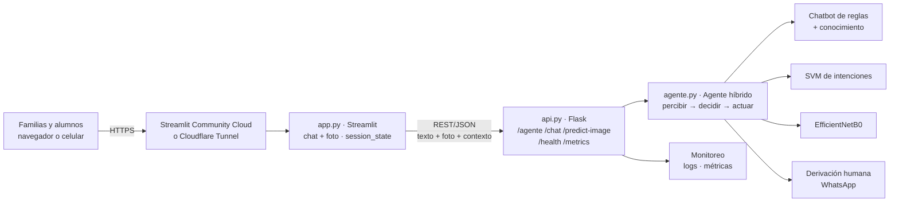

# 🥋 Asistente inteligente MDK Tuchtlán

Aplicación web que orienta a familias y alumnos de la escuela de taekwondo **MDK Tuchtlán** (Tuxtla Gutiérrez, Chiapas). Integra:

- **Procesamiento de lenguaje natural:** chatbot de reglas con base de conocimiento verificada, más un clasificador de intenciones (TF-IDF + LinearSVC, 6 intenciones).
- **Visión por computadora:** clasificador EfficientNetB0 (transferencia de aprendizaje) que reconoce **careta/casco, guantes, peto y uniforme**.
- **Agente inteligente híbrido:** decide qué componente usar, pide información cuando falta, recuerda el contexto y combina los resultados en una sola respuesta.

Proyecto final · Maestría en Inteligencia Artificial · Fernanda Gómez Gordillo · 2026

**URL pública:** `https://<tu-app>.streamlit.app` ← *(sustituir después de desplegar)*

---

## Arquitectura



- La **interfaz** no carga modelos: solo envía texto y fotos a la API y muestra resultados.
- La **API** valida las entradas, mide y registra cada solicitud, y es la única que toca los modelos (cargados una sola vez).
- La API es **sin estado**: el contexto de cada usuario (último artículo, mes consultado, pregunta pendiente) vive en su `st.session_state` y viaja con cada solicitud. Así dos usuarios nunca mezclan conversaciones.
- La API escucha en `127.0.0.1:5000`; solo la interfaz queda expuesta a internet.

## Agente híbrido: tabla de decisiones

| Regla | Situación percibida | Tipo | Acción |
|---|---|---|---|
| R0 | Llega una foto pero la CNN no está disponible | Seguridad | Responde con texto y avisa |
| R1 | Las reglas reconocen la intención | Reactiva | Chatbot de reglas |
| R2 | Reglas «desconocida» y SVM con margen ≥ 0.25 | Reactiva | SVM + respuesta controlada |
| R3 | SVM ambiguo o sin vocabulario | Reactiva | Deriva a WhatsApp |
| R4 | «Tengo este, ¿lo puedo llevar?» sin foto | Deliberativa | Pide la foto y guarda la pregunta |
| R5 | Foto con confianza ≥ 0.65 | Reactiva | CNN + respuesta a la pregunta concreta |
| R6 | Foto con confianza < 0.65 | Deliberativa | Pide otra foto y guarda la pregunta |
| R7 | El texto y la foto no coinciden | Deliberativa | Pide aclaración |
| R8 | «¿Y cuánto cuesta?» después de hablar de un artículo | Deliberativa | Usa la memoria de la conversación |
| R9 | Talla, autenticidad, estado u homologación | Seguridad | Declara el límite y remite a la escuela |

Cada respuesta incluye `decision`, `ruta` (componentes usados), `confianza`, `explicacion` y `siguiente_paso`. La interfaz los muestra en «¿Cómo decidió el asistente?».

## Estructura

```
app.py                  Interfaz Streamlit (consume la API)
api.py                  API REST Flask
mdk/
  conocimiento.py       Precios, horarios, dirección, promociones (único lugar para actualizarlos)
  chatbot.py            Chatbot de reglas (proyectos 1 y 2)
  datos_intenciones.py  Frases de entrenamiento y prueba independiente
  nlp.py                Preprocesamiento + TF-IDF + LinearSVC
  vision.py             Carga del modelo .keras, validación y preprocesamiento de imágenes
  agente.py             Agente híbrido (R0–R9)
modelos/                mdk_clasificador_visual.keras
evaluacion/             Casos de prueba del agente, métricas y modelo simulado para pruebas
tests/                  Pruebas automáticas (pytest)
notebooks/              MDK_Final_Colab.ipynb: pruebas, métricas, carga y túnel
```

## Ejecutar en local

```bash
pip install -r requirements.txt
streamlit run app.py          # inicia también la API en segundo plano
# o por separado:
python api.py                 # http://127.0.0.1:5000
AUTO_API=0 streamlit run app.py
```

Pruebas automáticas: `python -m pytest -q tests`

## API

| Método | Ruta | Entrada | Salida |
|---|---|---|---|
| GET | `/health` | — | estado de cada componente |
| GET | `/metrics` | — | solicitudes, códigos HTTP, latencia p50/p95, decisiones del agente, confianza visual |
| POST | `/agente` | multipart: `mensaje`, `contexto` (JSON), `file` opcional · o JSON | respuesta del agente |
| POST | `/chat` | JSON `{mensaje, contexto}` | respuesta del agente (solo texto) |
| POST | `/predict-image` | multipart `file` | clase, confianza, probabilidades |

Errores: **400** (entrada inválida: sin archivo, extensión no permitida, archivo que no es imagen, texto vacío o demasiado largo), **413** (más de 5 MB), **503** (modelo visual no disponible), **500** (mensaje genérico; el detalle queda solo en `logs/api.log`).

## Despliegue

**Streamlit Community Cloud (URL permanente):** en share.streamlit.io, *Create app* → este repositorio, rama `main`, archivo `app.py` → *Advanced settings*: Python 3.12 → *Deploy*. `app.py` inicia la API Flask dentro del mismo contenedor.

**Colab + Cloudflare Tunnel (demostración):** abre `notebooks/MDK_Final_Colab.ipynb` y ejecuta las celdas en orden.

**Render/Heroku (solo la API):** `Procfile` incluido (`gunicorn api:app`).

## Resultados principales

| Componente | Conjunto | Resultado |
|---|---|---|
| Intenciones · modelo del avance 2 (82 frases) | Prueba original (18) | 16/18 · accuracy 0.889 |
| Intenciones · modelo ampliado (202 frases) | Prueba original (18) | 17/18 · accuracy 0.944 |
| Intenciones · modelo ampliado | Prueba independiente (60) | 59/60 · accuracy 0.983 |
| Sistema completo (agente) | Prueba independiente (60) | 57/60 respuestas coherentes, 1 derivación |
| Agente | Matriz funcional (18 conversaciones, 23 turnos) | 23/23 con modelo simulado |
| Visión · EfficientNetB0 | Prueba del avance 2 (24) | 24/24 *(recalcular en el notebook)* |

Las frases de prueba fueron redactadas para el proyecto y no son conversaciones reales. El conjunto de imágenes es pequeño. Los resultados describen estas pruebas y no garantizan el desempeño con usuarios reales.

## Uso responsable

- Las fotos se procesan en memoria y no se guardan. El log registra hora, decisión, clase y confianza, nunca la imagen ni el mensaje completo.
- Se pide no fotografiar a niñas, niños ni a otras personas: solo el artículo.
- La foto identifica el **tipo** de artículo; no comprueba talla, autenticidad, estado ni homologación.
- Precios y promociones están en `mdk/conocimiento.py` y deben confirmarse con la escuela antes de difundir la app.
